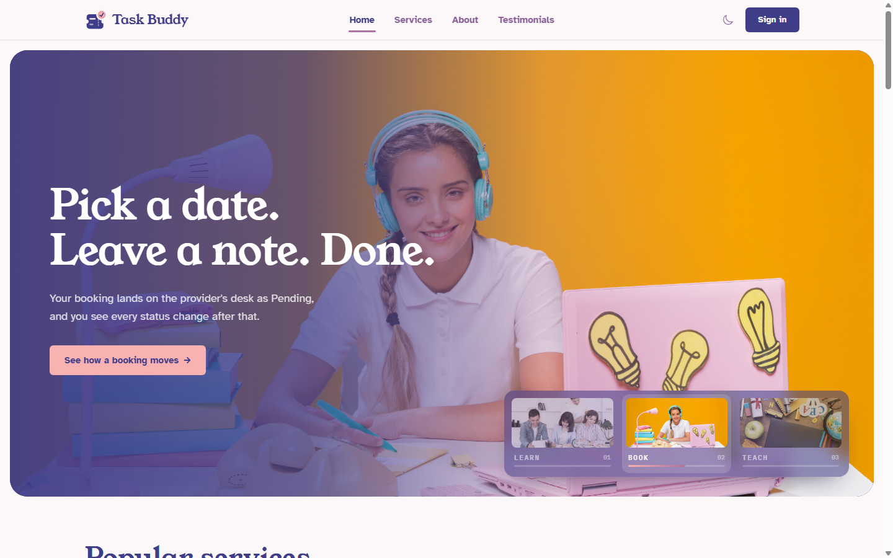
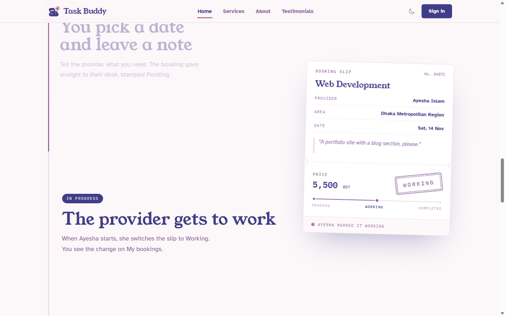
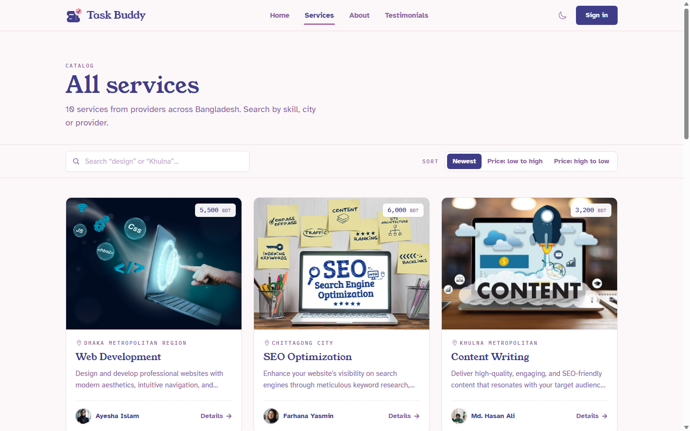
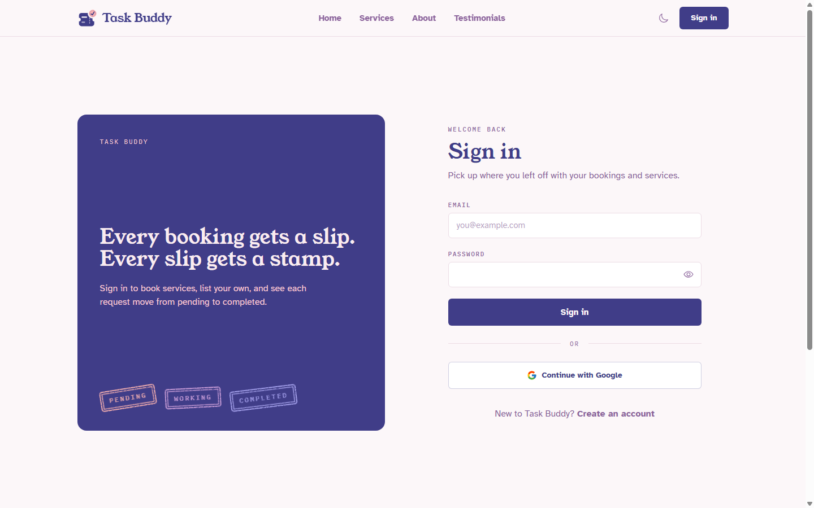

<div align="center">


# Task Buddy

**Book a skill from someone who has it.**

A service-sharing platform where providers across Bangladesh list skills and lessons, and learners book them, then follow every booking from **Pending** to **Completed**.

<br />

[](https://task-buddy-web-application.web.app/)
[](https://github.com/Rain44556/Service-Sharing-Web-Application-Task-Buddy-Server)


</div>

<br />



---

## Contents

- [What it does](#what-it-does)
- [How a booking moves](#how-a-booking-moves)
- [Screenshots](#screenshots)
- [Design system](#design-system)
- [Pages](#pages)
- [API](#api)
- [Run it locally](#run-it-locally)
- [Project structure](#project-structure)

---

## What it does

<table>
<tr>
<td width="50%" valign="top">

### For learners

- **Find a service.** Search the catalog by skill, city or provider, and sort by price.
- **Book it.** Pick a date and leave a note for the provider. Your details are filled in for you.
- **Track it.** *My bookings* shows every booking as a slip with its current status stamp, filterable by status.

</td>
<td width="50%" valign="top">

### For providers

- **List a service.** Add a name, price, area, image and description, with a live preview of the catalog card.
- **Manage your listings.** See listings, open requests, work in progress and the value of completed work. Edit or delete each service.
- **Work the requests.** *Booking requests* lets you switch each booking between Pending, Working and Completed.

</td>
</tr>
</table>

**Also included:** email/password and Google sign-in (Firebase), JWT cookie sessions for private routes, light and dark themes, and a layout that works from phone to desktop.

---

## How a booking moves

Every booking is drawn as a **slip** and carries a **status stamp**. The stamp's ink gets darker as the work progresses.

| Stage | Who acts | Stamp |
| :-- | :-- | :-- |
| **Browsing** | Learner finds a service in the catalog | — |
| **Pending** | Learner books a date and leaves a note |  |
| **Working** | Provider starts and marks it Working |  |
| **Completed** | Provider finishes and marks it Completed |  |

Both sides see the same slip: the learner on **My bookings**, the provider on **Booking requests**.

---

## Screenshots

<table>
<tr>
<td width="50%"><br /><sub><b>How a booking moves</b>: the slip fills in and is re-stamped as you scroll.</sub></td>
<td width="50%"><br /><sub><b>All services</b>: search by skill, city or provider; sort by price.</sub></td>
</tr>
<tr>
<td width="50%"><br /><sub><b>Sign in</b>: email/password or Google.</sub></td>
<td width="50%" valign="middle">

**Not pictured** (private pages, sign-in required):
Service details · Book a service · My bookings · Booking requests · Your services · Add a service

</td>
</tr>
</table>

---

## Design system

The interface is built around one idea from the product itself: **a booking slip and a rubber stamp**. Slips have notched edges and a tear line; stamps land with a spring animation whenever a status changes.


## Pages

| Route | Page | Access |
| :-- | :-- | :-- |
| `/` | Home: banner, popular services, how a booking moves, FAQ | Public |
| `/services` | All services: search and sort | Public |
| `/aboutus` | About | Public |
| `/testimonials` | Testimonials | Public |
| `/signin` · `/signup` | Sign in / create account | Public |
| `/singleServiceDetails/:id` | Service details | 🔒 Private |
| `/bookService/:id` | Book a service | 🔒 Private |
| `/bookedService` | My bookings (learner) | 🔒 Private |
| `/ServiceToDo` | Booking requests (provider) | 🔒 Private |
| `/ManageServices` | Your services | 🔒 Private |
| `/AddService` | Add a service | 🔒 Private |

---

## Project structure

```text
src/
├── common/          Navbar, Footer
├── components/
│   ├── ui/          Stamp, StatusTrack, Dialog, Logo, Avatar, PageHeader, EmptyState
│   ├── Banner.jsx         home image banner
│   ├── HowItWorks.jsx     scroll-driven booking slip
│   ├── ServiceCard.jsx    catalog card
│   └── BookingSlip.jsx    booking shown as a slip
├── context/         Auth and theme providers
├── layout/          MainLayout (page transitions, loading bar)
├── pages/           Public pages
├── privatePages/    Pages behind sign-in
├── router/          Routes and PrivateRoute
└── utils/format.js  Price, date and status helpers
```


## Run it locally

**Requirements:** Node.js 18+ and a Firebase project with Email/Password and Google sign-in enabled.

### 1. Client

```bash
git clone <this-repo-url>
cd task-buddy-client-side
npm install
```

Create `.env.local` with your Firebase web config:

```env
VITE_apiKey=
VITE_authDomain=
VITE_projectId=
VITE_storageBucket=
VITE_messagingSenderId=
VITE_appId=
```

```bash
npm run dev      # http://localhost:5173
```

> [!NOTE]
> Keep the dev server on port **5173**. The API's CORS settings allow that origin, so data won't load on other ports.

### 2. Server (optional, to run the API yourself)

```bash
git clone https://github.com/Rain44556/Service-Sharing-Web-Application-Task-Buddy-Server
cd task-buddy-server-side
npm install
```

Create `.env`:

```env
DB_USER=
DB_PASSWORD=
ACCESS_TOKEN_SECRET=
NODE_ENV=development
```

```bash
npm run dev      # http://localhost:5000, restarts on save
```
